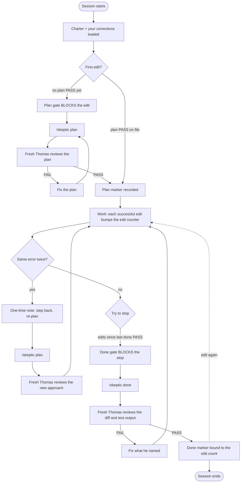
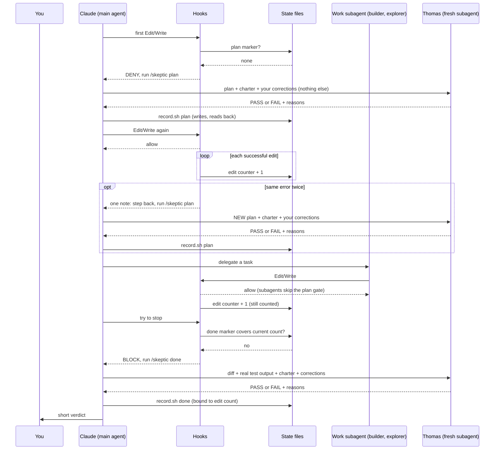

# Doubting Thomas

A fresh-context skeptic for Claude Code. Thomas reviews at three moments: before a plan, when the same error repeats, and before done. He gives a verdict (PASS or FAIL plus reasons) and never edits anything. Hooks make sure he is asked.

## The work loop



1. **Plan gate.** The first file edit of a session is blocked until `/skeptic plan` records a PASS.
2. **Same-error checkpoint.** The second time the same error appears, Claude gets one note telling it to step back and run `/skeptic plan` with a new plan, so Thomas reviews the approach again. The hook only nudges; the review itself is Claude running the command. Never blocks.
3. **Done gate.** A session that edited files cannot stop until `/skeptic done` records a PASS for the current edit count. Edit again after a PASS and it needs a new one.

`/skeptic` spawns a fresh subagent that sees only the artifact, the charter and the corrections log. Not the build conversation.

### Who talks to whom



Work subagents are never blocked by the plan gate, but their edits still raise the counter, so the done gate still demands a review of everything they changed. (Hook code does not filter them out of the count; that they share the parent's session id is not verified live.)

Thomas is asked three times: at the first plan, when the same error repeats, and before done. Each time it is Claude running `/skeptic`, never a hook.

Hooks never ask Thomas anything. They only read state and say yes or no, apart from two one-line notes to Claude: the same-error step-back and the correction-logging prompt. Thomas never sees the build conversation.

## What Thomas checks

The full text lives in [`charter.md`](charter.md). Thomas uses these as lenses on a plan or finished work, not as new requirements. He must name the principle and cite evidence for any FAIL, and he does no style nitpicking. For non-code work (documents, flyers, campaigns) the same ideas apply: look for existing assets first, keep to what was asked, verify before claiming.

- **Reuse before building.** Search the codebase, tools, libraries, docs and prior art first. Buy over build unless the need is core. Prefer boring, already-in-use technology. Every line added is a line to maintain.
- **Simplicity and scope.** KISS, YAGNI, Rule of Three. Do only what was asked. Make it work, make it right, make it fast.
- **Design.** DRY, separation of concerns, single responsibility, SOLID, composition over inheritance, Law of Demeter, high cohesion and low coupling, least astonishment.
- **Correctness and safety.** Fail fast, validate at the boundaries, least privilege, secure by default, idempotent and reversible, handle the empty, null, duplicate and failure cases.
- **Security.** Defense in depth, zero trust, server-side authentication and authorization, fail securely, threat-model it. Guard against injection and XSS, keep secrets out of code, encrypt data, pin and patch dependencies, log security events without logging secrets.
- **UX/UI.** Consistency with the project's own design system or conventions (Material Design, Apple HIG, custom tokens, whatever the project uses), clear hierarchy, visible status, error recovery, accessibility, responsive layout. Thomas does not impose a design system the project does not use.
- **PWA.** Only if the project is one. He does not require a PWA.
- **Graphic design.** Hierarchy, contrast, alignment, white space, a limited readable type scale, a consistent brand palette, sharp imagery, legible at its size and medium.
- **Verification.** Tests actually run, and a reported pass is not evidence. Reproduce a bug before fixing it and fix the root cause. Failures must tell someone.
- **Maintainability.** Readable over clever, comments explain why, small reversible changes, non-obvious decisions written down.

Two rules sit above all of these: Thomas judges only tool output he actually received (anything else is "not verified"), and a repeat of a logged correction is an automatic FAIL.

## What it does on your machine

Read this before you install, so you can decide whether you want it. Thomas is installed once and applies to every project and every Claude Code session on that machine, not just the repo you are in. It is shell scripts plus one slash command. The scripts make no network calls and send nothing anywhere. The one thing that costs real money and time is the review itself (see "What a review costs").

### While you work

- **It blocks edits until a plan is reviewed.** The first Edit, Write, MultiEdit or NotebookEdit by the main agent in a session is refused until `/skeptic plan` records a PASS. Subagents and Claude's own plan files (`*/.claude/plans/*`) are exempt.
- **It blocks finishing until the work is reviewed.** If the session made edits, Claude cannot stop until `/skeptic done` records a PASS for the current edit count. Any edit after a PASS re-arms the gate.
- **It nudges after a repeated error.** When the same tool failure happens a second time (numbers and hex addresses are ignored when comparing), Claude gets one note telling it to step back and re-plan. It never blocks.
- **It reads your messages for corrections.** Every prompt you send is checked locally with `grep` against a short list of phrases ("I told you...", "that's not what I asked", "stop adding..."). On a match, one hidden line asks Claude to log the correction. The hook itself stores nothing from your message; only what Claude chooses to write goes into `corrections.md`.
- **It adds the charter to every session.** The charter (about 6 KB) plus your corrections (up to 5 KB) are injected at session start, capped at 12 KB, with any single line cut at 600 characters. That is a small, constant cost in context tokens.
- **Every hook fails open.** If a hook cannot read or write its files, or the session has no id, the action goes through. A bug in Thomas cannot lock you out of your own session.

### What a review costs

Every `/skeptic` call starts a fresh Claude subagent that reads the artifact and runs commands and tests itself. That is extra model time and tokens on top of your normal work. A full review uses the strongest model available (`fable`, then `opus`, then your default). A light review (small documentation-only changes) uses `sonnet`. In our own use, a review took from under a minute for small changes to about six minutes for a large script change. Reviews happen at the first plan, when the same error repeats and you re-plan, and before done; each edit after a done PASS needs a new done review. `--defer` skips a review and records that none happened.

Hooks are fast. On a Linux test machine each one took roughly 5 to 25 ms, and each has a 15-second timeout. The edit hooks run twice per edit (before and after), the correction check once per message you send.

### What it writes to disk

Everything lives in `~/.claude/skeptic/` unless noted.

| Path | What it is | Growth limit | Cleaned up? |
| --- | --- | --- | --- |
| `bin/` | The scripts. Copied at install, and again at every session start for plugin installs. | Fixed | Overwritten each time |
| `charter.md` | The charter Thomas judges by. Copied from the repo at install, and again at every session start for plugin installs. | Fixed | **Overwritten each time. Do not edit it; put your own rules in `corrections.md`.** |
| `corrections.md` | Your corrections, newest first. Yours to edit; new corrections are added at the top when you correct Claude. Never overwritten by updates. | About 5 KB | Overflow moves to the archive |
| `corrections-archive.md` | Corrections that no longer fit in `corrections.md`. | One line per correction | Never trimmed |
| `history.log` | One line per review: when, session, plan or done, pass, fail or skipped, principle, a short note. | 500 lines | When it passes 500 lines it is cut to the newest 400 |
| `ledger` | One receipt line (about 70 bytes) per PASS, so a commit message can prove a review happened. | Grows slowly | Never trimmed |
| `state/<session>/` | A few tiny marker files per session: plan, done, edit count, repeated errors. | One folder per session | **Garbage collected (below)** |
| `~/.claude/commands/skeptic.md` | The `/skeptic` command. Written by `install.sh` only. | Fixed | Removed by `uninstall.sh` |
| `~/.claude/settings.json` | `install.sh` only: adds the hook entries. | Fixed | Entries removed by `uninstall.sh` |
| `~/.claude/settings.json.bak.<time>.<pid>` | `install.sh` only: a backup made on every run. | One file per install run | **Never cleaned. Delete old ones yourself.** |

### Garbage collection

At the start of every session, `session-start.sh` deletes session state folders under `~/.claude/skeptic/state/` that have not changed in more than 7 days. It runs `find ... -mindepth 1 -maxdepth 1 -type d -mtime +7 -exec rm -rf`, so it touches only those folders and nothing else. There is no cron job or background process; it simply happens when a session starts.

Two consequences. A session left idle for more than a week loses its markers, so its next edit needs a fresh plan review. And the things that are not collected are the ones in the table above marked "Never trimmed" (the ledger, the corrections archive and the settings backups). They grow slowly, but they do grow.

### Hooks it registers

| Event | Script | Runs when | What it does |
| --- | --- | --- | --- |
| SessionStart | `session-start.sh` | A session starts | Copies scripts and charter into place (plugin installs), deletes old state folders, injects the charter and your corrections |
| UserPromptSubmit | `prompt-submit.sh` | You send a message | Matches correction phrases and adds one hidden note to Claude |
| PreToolUse (Edit, Write, NotebookEdit, MultiEdit) | `plan-gate.sh` | Before each edit | Refuses the first edit until a plan is reviewed |
| PostToolUse (same tools) | `post-tool.sh` | After each successful edit | Adds one to the edit counter |
| PostToolUseFailure | `post-tool.sh` | After any failed tool call | Counts repeated errors, nudges on the second |
| Stop | `done-gate.sh` | Claude tries to finish | Refuses until a done review covers the current edit count |

### Network and privacy

The hooks and scripts make no network calls, and there is no telemetry. `install.sh` needs `python3` only to merge `settings.json`. The reviewer is Claude itself, so the diff, the test output, the charter and your corrections go to the model the same way the rest of your session does. The history, ledger and corrections files hold one short line per review or correction and stay on your machine.

### Taking it out

`bash scripts/uninstall.sh` removes only Thomas's hook entries (matched by their path) and the `/skeptic` command; restart Claude Code afterwards. It leaves `~/.claude/skeptic/` and its data in place. `bash scripts/uninstall.sh --restore-backup` instead restores the newest `settings.json` backup, which discards any settings changes you made after installing. To delete all of Thomas's data, remove the `~/.claude/skeptic` folder. A plugin install is removed from your plugin settings.

### Is it for you?

It fits if you let Claude change real code or documents and want an independent second opinion enforced rather than optional, and you accept that sessions end a little slower and cost extra review tokens.

Skip it if you want zero friction, mostly do throwaway scripts, or do not want an agent reviewing your diffs at all. Even then, `--defer` and the light review keep the cost down, and `uninstall.sh` takes it out cleanly.

## Install

**In Claude (Cowork / claude.ai):** download `dist/doubting-thomas.plugin` from this repo (https://github.com/billmote/doubting-thomas/raw/main/dist/doubting-thomas.plugin) and upload it as a plugin in your Claude settings. There is no `/plugin` command in Cowork sessions. Start a new session afterwards.

**In Claude Code (terminal):**

```
/plugin marketplace add https://github.com/billmote/doubting-thomas
/plugin install doubting-thomas@doubting-thomas
```

Restart the session. No plugin support? Use `bash scripts/install.sh` (merges hooks into `~/.claude/settings.json`, backs it up first; undo with `scripts/uninstall.sh`).

## Requirements

- Claude Code with hooks and plugins.
- `bash` plus standard Unix tools (`awk`, `sed`, `grep`, `cksum`, `date`, `find`, `cut`, `tr`, `head`, `tail`, `wc`, `cp`, `mv`, `mkdir`). Stock macOS (bash 3.2) and Linux are fine. No `jq`, `python3` or `git` needed by the hooks. `git` is used only by `risk.sh` to pick the review depth.
- Windows: use WSL or Git Bash.
- The reviewer model. `/skeptic` tries `fable`, then `opus`, then your default. Any model works, a stronger one reviews better.
- Python 3 only for `scripts/install.sh` and `scripts/uninstall.sh` (the settings merge).

## Make it yours

Your corrections go in `~/.claude/skeptic/corrections.md`. Newest first, dated, before and after. Thomas is given it every session and at every review, and updates never overwrite it. A repeat of a logged correction is an automatic FAIL.

**It fills itself.** When a message of yours sounds like a correction ("I told you...", "that's not what I asked", "stop adding..."), a hook asks Claude to log it silently with `log-correction.sh`. The match is deliberately narrow, so Claude is told to log nothing if the message is only a task. The file stays under about 5 KB; older lines move to `corrections-archive.md`, never deleted. You can still edit the file by hand.

**Review depth.** `/skeptic done` runs `risk.sh` first. A small documentation-only change (40 changed lines or fewer, no secret-looking lines, nothing that steers an agent such as the charter, corrections, skills, prompts, commands or hooks) gets a quick review on a lighter model. Anything else, or any doubt, gets the full review. `--full` forces it. The review is never skipped, only scaled. A plan review is always full. Without git, every review is full.

**What actually catches things.** Every review is logged in `~/.claude/skeptic/history.log` (last 500). A FAIL starts with the principle it broke, such as `[reuse]`. `/skeptic stats` shows failures by principle and, after 20 reviews, which principles have never caused one, so you can trim the charter. It only reports; it never edits the charter.

## Honest limits

- Edits made from the shell (`sed -i`, heredocs, redirects) are not gated or counted. Only Edit, Write, MultiEdit and NotebookEdit.
- Auto-logging corrections is a phrase match, so it misses corrections worded differently (log those by hand) and can fire on a message that is not one. Claude is told to log nothing in that case, but it is Claude's judgment, so skim `corrections.md` now and then.
- `risk.sh` judges only uncommitted changes. If you commit code mid-session and then tweak a README, that last change is rated light. Use `--full` when in doubt.
- `--defer` records NO review. The marker is an honesty checkpoint, not a security control; the agent could call the helper directly.
- Every hook fails open. An unwritable state dir or missing session id lets the action through, so a bug never bricks a session.
- Subagents are never gated.
- Edits to Claude's own plan files (`*/.claude/plans/*`) are neither gated nor counted.
- Thomas's session context is capped (about 12 KB across charter and your corrections), so keep `corrections.md` short.

## Test

```
bash tests/test.sh
```

## Change log

### 1.1.0 (2026-10-19)

**Added**
- **Engineering principles in the charter.** Thomas now judges by named principles instead of only "does it already exist?": reuse before building, simplicity and scope (KISS, YAGNI), design (DRY, SOLID and friends), correctness and safety, security, UX/UI, PWA (only if the project is one), graphic design, verification and maintainability. They are lenses, not new requirements, and the UX/UI and PWA ones defer to whatever design system the project already uses. See "What Thomas checks".
- **A self-filling corrections log.** A new `UserPromptSubmit` hook (`prompt-submit.sh`) spots correction phrases in your messages and asks Claude to log them with the new `log-correction.sh`. Newest first, deduplicated, kept under about 5 KB, with overflow moved to `corrections-archive.md`.
- **Risk-scaled reviews.** New `risk.sh` rates a done review `light` or `full`. Small documentation-only changes with no secret-looking lines, and nothing that steers an agent, get a quick review on a lighter model. Everything else, and any doubt, gets the full one. `/skeptic done --full` forces a full review.
- **A review history.** Every review is logged to `history.log` (capped at 500 lines). A FAIL now starts with the principle it broke, such as `[reuse]`. New `/skeptic stats` (via `history.sh`) shows failures by principle and, after 20 reviews, which principles have never caused one.
- **"What it does on your machine".** A full disclosure section: what the hooks block, what a review costs, every file written, garbage collection, the hooks it registers, privacy, and how to take it out.
- Test coverage grew from 44 to 72 checks.

**Changed**
- The charter grew from about 2.4 KB to about 6 KB, so a little more context is injected at every session start.
- `/skeptic` accepts `stats` and `--full`.
- `record.sh` also writes a history line for each PASS or deferral. Gates, markers and receipts are unchanged.
- `install.sh` registers the new `UserPromptSubmit` hook. The plugin bundle in `dist/` was rebuilt and now includes the new scripts.

**Upgrading**
- Terminal install: `git pull`, then `bash scripts/install.sh` again (safe to re-run; it backs up `settings.json` first).
- Plugin install: upload the new `dist/doubting-thomas.plugin` and start a new session.
- Either way the charter is overwritten with the new one, so keep your own rules in `corrections.md`.

### 1.0.0 (2026-10-17)

First release.
- **Plan gate.** The first edit of a session is refused until `/skeptic plan` records a PASS.
- **Done gate.** A session that made edits cannot finish until `/skeptic done` records a PASS for the current edit count.
- **Same-error nudge.** The second identical failure adds a one-time note to step back and re-plan.
- **`/skeptic` command.** Starts a fresh subagent that sees only the artifact, the charter and your corrections.
- **Charter and corrections log.** A repeat of a logged correction is an automatic FAIL.
- **Receipts and ledger.** Each PASS prints a receipt so a commit message can show a review was earned.
- **Garbage collection** of session state folders older than 7 days at every session start.
- Every hook fails open. `install.sh`, `uninstall.sh`, the plugin bundle and 44 tests.
