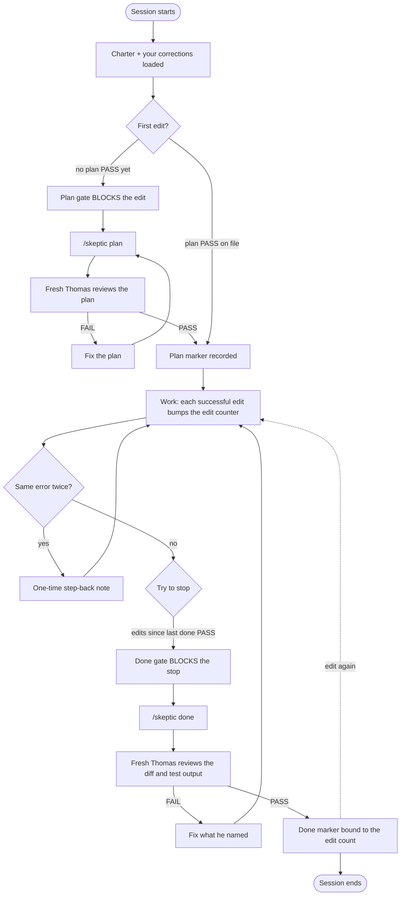

# Doubting Thomas

A fresh-context skeptic for Claude Code. Thomas reviews your work and gives a verdict (PASS or FAIL plus reasons). He never edits anything. Hooks make sure he is asked.

## The work loop



1. **Plan gate.** The first file edit of a session is blocked until `/skeptic plan` records a PASS.
2. **Same-error nudge.** The second time the same error appears, you get one "step back, are we digging in the wrong place?" note. Never blocks.
3. **Done gate.** A session that edited files cannot stop until `/skeptic done` records a PASS for the current edit count. Edit again after a PASS and it needs a new one.

`/skeptic` spawns a fresh subagent that sees only the artifact, the charter and the corrections log. Not the build conversation.

## Install

In Claude Code:

```
/plugin marketplace add billmote/doubting-thomas
/plugin install doubting-thomas@doubting-thomas
```

Restart the session. No plugin support? Use `bash scripts/install.sh` (merges hooks into `~/.claude/settings.json`, backs it up first; undo with `scripts/uninstall.sh`).

## Requirements

- Claude Code with hooks and plugins.
- `bash` plus standard Unix tools (`awk`, `sed`, `grep`, `cksum`, `date`, `find`, `cut`, `tr`, `head`, `cp`, `mv`, `mkdir`). Stock macOS (bash 3.2) and Linux are fine. No `jq`, `python3` or `git` needed by the hooks.
- Windows: use WSL or Git Bash.
- The reviewer model. `/skeptic` tries `fable`, then `opus`, then your default. Any model works, a stronger one reviews better.
- Python 3 only for `scripts/install.sh` and `scripts/uninstall.sh` (the settings merge).

## Make it yours

Your corrections go in `~/.claude/skeptic/corrections.md` (create it). Newest first, dated, before and after. Thomas is given it every session and at every review, and updates never overwrite it. A repeat of a logged correction is an automatic FAIL.

## Honest limits

- Edits made from the shell (`sed -i`, heredocs, redirects) are not gated or counted. Only Edit, Write, MultiEdit and NotebookEdit.
- `--defer` records NO review. The marker is an honesty checkpoint, not a security control; the agent could call the helper directly.
- Every hook fails open. An unwritable state dir or missing session id lets the action through, so a bug never bricks a session.
- Subagents are never gated.
- Edits to Claude's own plan files (`*/.claude/plans/*`) are neither gated nor counted.
- Thomas's session context is capped (about 12 KB across charter and your corrections), so keep `corrections.md` short.

## Test

```
bash tests/test.sh
```
