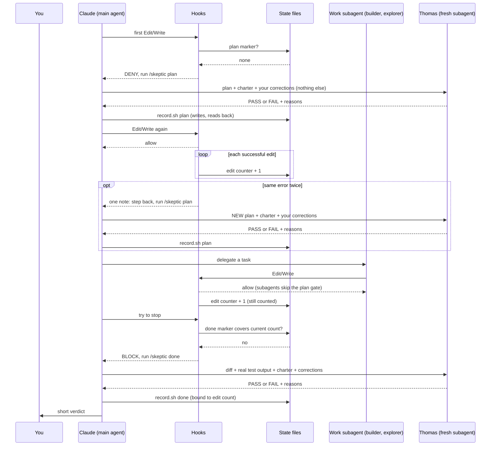

# Doubting Thomas

A fresh-context skeptic for Claude Code. Thomas reviews at three moments: before a plan, when the same error repeats, and before done. He gives a verdict (PASS or FAIL plus reasons) and never edits anything. Hooks make sure he is asked.

## The work loop


1. **Plan gate.** The first file edit of a session is blocked until `/skeptic plan` records a PASS.
2. **Same-error checkpoint.** The second time the same error appears, Claude gets one note telling it to step back and run `/skeptic plan` with a new plan, so Thomas reviews the approach again. The hook only nudges; the review itself is Claude running the command. Never blocks.
3. **Done gate.** A session that edited files cannot stop until `/skeptic done` records a PASS for the current edit count. Edit again after a PASS and it needs a new one.

`/skeptic` spawns a fresh subagent that sees only the artifact, the charter and the corrections log. Not the build conversation.

### Who talks to whom



Work subagents are never blocked by the plan gate, but their edits still raise the counter, so the done gate still demands a review of everything they changed. (Hook code does not filter them out of the count; that they share the parent's session id is not verified live.)

Thomas is asked three times: at the first plan, when the same error repeats, and before done. Each time it is Claude running `/skeptic`, never a hook.

Hooks never ask Thomas anything. They only read state and say yes or no, apart from two one-line notes to Claude: the same-error step-back and the correction-logging prompt. Thomas never sees the build conversation.

## What Thomas checks

The full text lives in [`charter.md`](charter.md). Thomas uses these as lenses on a plan or finished work, not as new requirements. He must name the principle and cite evidence for any FAIL, and he does no style nitpicking. For non-code work (documents, flyers, campaigns) the same ideas apply: look for existing assets first, keep to what was asked, verify before claiming.

- **Reuse before building.** Search the codebase, tools, libraries, docs and prior art first. Buy over build unless the need is core. Prefer boring, already-in-use technology. Every line added is a line to maintain.
- **Simplicity and scope.** KISS, YAGNI, Rule of Three. Do only what was asked. Make it work, make it right, make it fast.
- **Design.** DRY, separation of concerns, single responsibility, SOLID, composition over inheritance, Law of Demeter, high cohesion and low coupling, least astonishment.
- **Correctness and safety.** Fail fast, validate at the boundaries, least privilege, secure by default, idempotent and reversible, handle the empty, null, duplicate and failure cases.
- **Security.** Defense in depth, zero trust, server-side authentication and authorization, fail securely, threat-model it. Guard against injection and XSS, keep secrets out of code, encrypt data, pin and patch dependencies, log security events without logging secrets.
- **UX/UI.** Consistency with the project's own design system or conventions (Material Design, Apple HIG, custom tokens, whatever the project uses), clear hierarchy, visible status, error recovery, accessibility, responsive layout. Thomas does not impose a design system the project does not use.
- **PWA.** Only if the project is one. He does not require a PWA.
- **Graphic design.** Hierarchy, contrast, alignment, white space, a limited readable type scale, a consistent brand palette, sharp imagery, legible at its size and medium.
- **Verification.** Tests actually run, and a reported pass is not evidence. Reproduce a bug before fixing it and fix the root cause. Failures must tell someone.
- **Maintainability.** Readable over clever, comments explain why, small reversible changes, non-obvious decisions written down.

Two rules sit above all of these: Thomas judges only tool output he actually received (anything else is "not verified"), and a repeat of a logged correction is an automatic FAIL.

## Install

**In Claude (Cowork / claude.ai):** download `dist/doubting-thomas.plugin` from this repo (https://github.com/billmote/doubting-thomas/raw/main/dist/doubting-thomas.plugin) and upload it as a plugin in your Claude settings. There is no `/plugin` command in Cowork sessions. Start a new session afterwards.

**In Claude Code (terminal):**

```
/plugin marketplace add https://github.com/billmote/doubting-thomas
/plugin install doubting-thomas@doubting-thomas
```

Restart the session. No plugin support? Use `bash scripts/install.sh` (merges hooks into `~/.claude/settings.json`, backs it up first; undo with `scripts/uninstall.sh`).

## Requirements

- Claude Code with hooks and plugins.
- `bash` plus standard Unix tools (`awk`, `sed`, `grep`, `cksum`, `date`, `find`, `cut`, `tr`, `head`, `tail`, `wc`, `cp`, `mv`, `mkdir`). Stock macOS (bash 3.2) and Linux are fine. No `jq`, `python3` or `git` needed by the hooks. `git` is used only by `risk.sh` to pick the review depth.
- Windows: use WSL or Git Bash.
- The reviewer model. `/skeptic` tries `fable`, then `opus`, then your default. Any model works, a stronger one reviews better.
- Python 3 only for `scripts/install.sh` and `scripts/uninstall.sh` (the settings merge).

## Make it yours

Your corrections go in `~/.claude/skeptic/corrections.md`. Newest first, dated, before and after. Thomas is given it every session and at every review, and updates never overwrite it. A repeat of a logged correction is an automatic FAIL.

**It fills itself.** When a message of yours sounds like a correction ("I told you...", "that's not what I asked", "stop adding..."), a hook asks Claude to log it silently with `log-correction.sh`. The match is deliberately narrow, so Claude is told to log nothing if the message is only a task. The file stays under about 5 KB; older lines move to `corrections-archive.md`, never deleted. You can still edit the file by hand.

**Review depth.** `/skeptic done` runs `risk.sh` first. A small documentation-only change (40 changed lines or fewer, no secret-looking lines, nothing that steers an agent such as the charter, corrections, skills, prompts, commands or hooks) gets a quick review on a lighter model. Anything else, or any doubt, gets the full review. `--full` forces it. The review is never skipped, only scaled. A plan review is always full. Without git, every review is full.

**What actually catches things.** Every review is logged in `~/.claude/skeptic/history.log` (last 500). A FAIL starts with the principle it broke, such as `[reuse]`. `/skeptic stats` shows failures by principle and, after 20 reviews, which principles have never caused one, so you can trim the charter. It only reports; it never edits the charter.

## Honest limits

- Edits made from the shell (`sed -i`, heredocs, redirects) are not gated or counted. Only Edit, Write, MultiEdit and NotebookEdit.
- Auto-logging corrections is a phrase match, so it misses corrections worded differently (log those by hand) and can fire on a message that is not one. Claude is told to log nothing in that case, but it is Claude's judgment, so skim `corrections.md` now and then.
- `risk.sh` judges only uncommitted changes. If you commit code mid-session and then tweak a README, that last change is rated light. Use `--full` when in doubt.
- `--defer` records NO review. The marker is an honesty checkpoint, not a security control; the agent could call the helper directly.
- Every hook fails open. An unwritable state dir or missing session id lets the action through, so a bug never bricks a session.
- Subagents are never gated.
- Edits to Claude's own plan files (`*/.claude/plans/*`) are neither gated nor counted.
- Thomas's session context is capped (about 12 KB across charter and your corrections), so keep `corrections.md` short.

## Test

```
bash tests/test.sh
```
